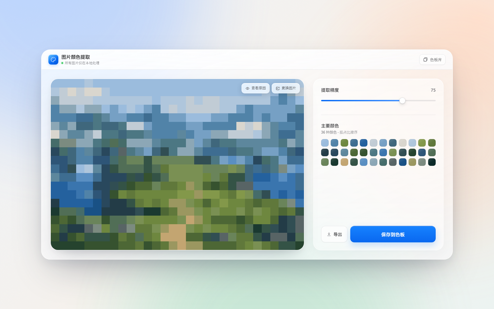

# 图片颜色提取

一款纯前端、完全本地运行的图片取色与色板导出工具。界面采用 macOS 风格的磨砂玻璃设计，自适应桌面与移动端。



## 功能

- **完全本地处理**：图片不会上传，所有取色、保存与导出均在浏览器中完成。
- **主色提取**：使用加权 k-means 聚类提取图片配色，精度滑杆可用于控制颜色数量。
- **按占比排序**：色板按每种颜色的实际覆盖比例从高到低排列。
- **像素调色预览**：以提取出的色板重建像素化预览，随窗口尺寸自动重绘。
- **灵活导入**：支持文件选择、拖拽、粘贴，取色过程中可随时更换图片。
- **便捷复制**：点击任意色块即可复制 HEX 色值，并显示该颜色的占比。
- **本地色板库**：保存的色板会写入浏览器本地存储，可重复查看和删除。
- **多格式导出**：支持 CSS、JSON、GIMP GPL 和 Adobe ASE 四种常用格式。

## 使用方式

项目没有构建步骤和第三方依赖。

### 直接打开

下载或克隆仓库后，直接打开 `index.html`。

### 本地静态服务器

也可以启动一个静态服务器：

```bash
# Node.js
npx serve .

# Python
python3 -m http.server 8000
```

然后访问终端提示的本地地址。

## 导出格式

| 格式 | 扩展名 | 适用场景 |
| --- | --- | --- |
| CSS 变量 | `.css` | 网页与设计系统，包含颜色占比注释 |
| JSON 数据 | `.json` | 包含 HEX、RGB、HSL 与占比数据 |
| GIMP 色板 | `.gpl` | GIMP、Krita、Inkscape 等 |
| Adobe 色板 | `.ase` | Photoshop、Illustrator 等 |

## 实现说明

- 使用 Canvas 在本地读取图片像素，并将采样区域控制在轻量尺寸。
- 颜色聚类在 CIELAB 色彩空间中进行，结果更接近人眼感知。
- 滑块默认值 75 对应约 36 种颜色；范围大致覆盖 5 至 48 种颜色。
- 色块按像素占比降序排列，导出的色板顺序与界面一致。
- 像素预览使用调色板还原画面，窗口尺寸变化时自动重新绘制。
- 色板库保存在浏览器的 `localStorage` 中。
- 未使用任何前端框架或外部图标、字体资源。

## 文件结构

```text
.
├── index.html          # 页面结构与内联 SVG 图标
├── styles.css          # 自适应布局与 macOS 风格视觉
├── app.js              # 图片处理、聚类、色板与导出逻辑
├── assets/
│   └── sample.js       # 内嵌示例图片，仅用于首次演示
├── preview.png         # README 界面预览图
├── LICENSE
└── .gitignore
```

## 浏览器支持

建议使用较新版本的 Chrome、Edge、Safari 或 Firefox。应用依赖 Canvas、`<dialog>`、ResizeObserver 与现代 CSS；不支持毛玻璃效果的环境会自动回退为普通浅色背景。

## 隐私

项目没有后端服务，也不会请求远程接口。图片、色板及导出文件都只在当前设备上处理。使用剪贴板自动复制失败时，界面会直接显示对应色值。

## 示例图片

首次打开页面时展示的示例插画由 AI 生成，仅用于演示取色与色板功能。你可以通过预览图右上角的「更换图片」加载自己的图片。

## License

[MIT](./LICENSE) © 2026 Joshua-Zion
